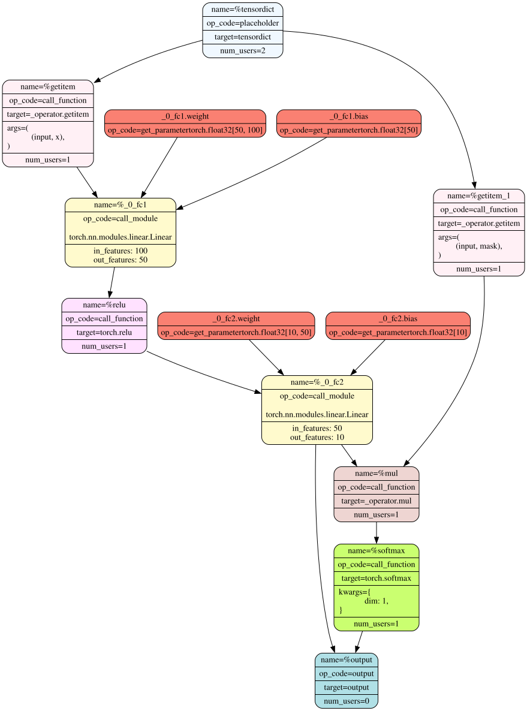

# FX tracing (prototype)

`tensordict.prototype.fx.symbolic_trace()` traces a
[`TensorDictModule`](reference/generated/tensordict.nn.TensorDictModule.html#tensordict.nn.TensorDictModule) or a
[`TensorDictSequential`](reference/generated/tensordict.nn.TensorDictSequential.html#tensordict.nn.TensorDictSequential) into a [`torch.fx`](https://docs.pytorch.org/docs/stable/fx.html#module-torch.fx) graph
that you can read and transform. Use it instead of
[`torch.fx.symbolic_trace()`](https://docs.pytorch.org/docs/stable/fx.html#torch.fx.symbolic_trace), which raises `TypeError: 'TensorDictModule'
object is not subscriptable` on a [`TensorDictModule`](reference/generated/tensordict.nn.TensorDictModule.html#tensordict.nn.TensorDictModule).

Warning

`tensordict.prototype.fx` is a prototype. Its API can change without a
deprecation cycle. To make a module faster or to export it, use
[`torch.compile()`](https://docs.pytorch.org/docs/stable/generated/torch.compile.html#torch.compile) or [`torch.export.export()`](https://docs.pytorch.org/docs/stable/user_guide/torch_compiler/export/api_reference.html#torch.export.export) (see
[torch.compile, torch.func, torch.export, and CUDA graphs](compile.html#compile)). If you find a problem, open an issue.

## Trace a `TensorDictModule`

This example creates a [`TensorDictModule`](reference/generated/tensordict.nn.TensorDictModule.html#tensordict.nn.TensorDictModule) (see
[Modules: TensorDictModule and tensordict.nn](modules.html#modules-guide)), traces it, and prints the graph and the generated
code.

Tracing a TensorDictModule

```
>>> import torch
>>> import torch.nn as nn
>>> from tensordict import TensorDict
>>> from tensordict.nn import TensorDictModule
>>> from tensordict.prototype.fx import symbolic_trace

>>> class Net(nn.Module):
... def __init__(self):
... super().__init__()
... self.linear = nn.LazyLinear(1)
...
... def forward(self, x):
... logits = self.linear(x)
... return logits, torch.sigmoid(logits)
>>> module = TensorDictModule(
... Net(),
... in_keys=["input"],
... out_keys=[("outputs", "logits"), ("outputs", "probabilities")],
... )
>>> graph_module = symbolic_trace(module)
>>> print(graph_module.graph)
graph():
 %tensordict : [num_users=1] = placeholder[target=tensordict]
 %getitem : [num_users=1] = call_function[target=operator.getitem](args = (%tensordict, input), kwargs = {})
 %linear : [num_users=2] = call_module[target=linear](args = (%getitem,), kwargs = {})
 %sigmoid : [num_users=1] = call_function[target=torch.sigmoid](args = (%linear,), kwargs = {})
 return (linear, sigmoid)
>>> print(graph_module.code.strip())
def forward(self, tensordict):
 getitem = tensordict['input']; tensordict = None
 linear = self.linear(getitem); getitem = None
 sigmoid = torch.sigmoid(linear)
 return (linear, sigmoid)
```

A forward pass with each module gives the same outputs:

```
>>> tensordict = TensorDict({"input": torch.randn(32, 100)}, [32])
>>> module_out = module(tensordict, tensordict_out=TensorDict())
>>> graph_module_out = graph_module(tensordict, tensordict_out=TensorDict())
>>> assert (
... module_out["outputs", "logits"] == graph_module_out["outputs", "logits"]
... ).all()
>>> assert (
... module_out["outputs", "probabilities"]
... == graph_module_out["outputs", "probabilities"]
... ).all()
```

## Trace a `TensorDictSequential`

`symbolic_trace()` also traces a
[`TensorDictSequential`](reference/generated/tensordict.nn.TensorDictSequential.html#tensordict.nn.TensorDictSequential). The whole sequence becomes one
graph: each module gets its inputs from the outputs of the modules before it
in the graph, not from the input [`TensorDict`](reference/generated/tensordict.TensorDict.html#tensordict.TensorDict). This
example traces a sequence of two modules:

Tracing TensorDictSequential

```
>>> import torch
>>> import torch.nn as nn
>>> from tensordict import TensorDict
>>> from tensordict.nn import TensorDictModule, TensorDictSequential
>>> from tensordict.prototype.fx import symbolic_trace

>>> class Net(nn.Module):
... def __init__(self, input_size=100, hidden_size=50, output_size=10):
... super().__init__()
... self.fc1 = nn.Linear(input_size, hidden_size)
... self.fc2 = nn.Linear(hidden_size, output_size)
...
... def forward(self, x):
... x = torch.relu(self.fc1(x))
... return self.fc2(x)
>>> class Masker(nn.Module):
... def forward(self, x, mask):
... return torch.softmax(x * mask, dim=1)
>>> net = TensorDictModule(
... Net(), in_keys=[("input", "x")], out_keys=[("intermediate", "x")]
... )
>>> masker = TensorDictModule(
... Masker(),
... in_keys=[("intermediate", "x"), ("input", "mask")],
... out_keys=[("output", "probabilities")],
... )
>>> module = TensorDictSequential(net, masker)
>>> graph_module = symbolic_trace(module)
>>> print(graph_module.code.strip())
def forward(self, tensordict):
 getitem = tensordict[('input', 'x')]
 _0_fc1 = getattr(self, "0").module.fc1(getitem); getitem = None
 relu = torch.relu(_0_fc1); _0_fc1 = None
 _0_fc2 = getattr(self, "0").module.fc2(relu); relu = None
 getitem_1 = tensordict[('input', 'mask')]; tensordict = None
 mul = _0_fc2 * getitem_1; getitem_1 = None
 softmax = torch.softmax(mul, dim = 1); mul = None
 return (_0_fc2, softmax)
```

To draw the graph, install the `pydot`
package and the Graphviz `dot` program:

Visualizing the graph

```
>>> import os
>>> import tempfile
>>> from torch.fx.passes.graph_drawer import FxGraphDrawer
>>> g = FxGraphDrawer(graph_module, "sequential") 
>>> path = os.path.join(tempfile.mkdtemp(), "graph.svg")
>>> with open(path, "wb") as f: 
... _ = f.write(g.get_dot_graph().create_svg())
```

The result is this drawing:



## Limitations

The traced module is a `TDGraphModule`. It differs from the module that it
traces:

- It ignores `selected_out_keys` of a
[`TensorDictSequential`](reference/generated/tensordict.nn.TensorDictSequential.html#tensordict.nn.TensorDictSequential). It writes every
`out_keys` entry of every module in the sequence, including the
intermediate ones, such as `("intermediate", "x")` above.
- It takes a tensordict only. A call with tensors as keyword arguments, such
as `graph_module(x=torch.randn(32, 100))`, raises `TypeError`.
- It writes its outputs into the input tensordict, unless you pass
`tensordict_out`.

## See also

- [torch.compile, torch.func, torch.export, and CUDA graphs](compile.html#compile): [`torch.compile()`](https://docs.pytorch.org/docs/stable/generated/torch.compile.html#torch.compile) and [`torch.export.export()`](https://docs.pytorch.org/docs/stable/user_guide/torch_compiler/export/api_reference.html#torch.export.export)
with tensordicts and tensordict modules.
- [Modules: TensorDictModule and tensordict.nn](modules.html#modules-guide): [`TensorDictModule`](reference/generated/tensordict.nn.TensorDictModule.html#tensordict.nn.TensorDictModule) and
[`TensorDictSequential`](reference/generated/tensordict.nn.TensorDictSequential.html#tensordict.nn.TensorDictSequential).
- The PyTorch documentation of [`torch.fx`](https://docs.pytorch.org/docs/stable/fx.html#module-torch.fx).