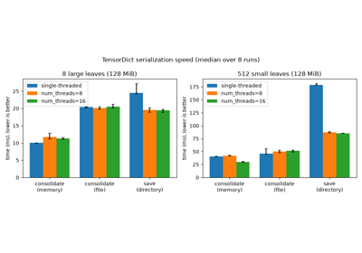

# Tutorials

Each tutorial solves one task with a script that runs from top to bottom on a
CPU. The documentation build runs every script, so the output on each page
comes from the code above it. Each page has links to download the script and
a Jupyter notebook, and ends with a "Further reading" list of the guides and
API pages that go deeper. If you are new to tensordict, read
[Getting started](../getting_started.html#getting-started) first.

The sidebar lists the tutorials in four groups, in reading order:

- Basics: keys, indexing, shapes, row-by-row filling, and lazy stacks of
streamed data.
- Storage: devices and memory-mapped tensors, the zarr backend, and a
benchmark of the serialization formats.
- tensordict.nn: modules that read and write tensordicts, functional calls and
ensembles, and export with `torch.export`.
- Data loading: datasets in a `TensorDict` or a `TensorClass`, and batched
loading of an image dataset.

[Getting, setting, and nesting keys](tensordict_keys.html)

Getting, setting, and nesting keys

[Slicing, indexing, and masking](tensordict_slicing.html)

Slicing, indexing, and masking

[Changing the shape of a TensorDict](tensordict_shapes.html)

Changing the shape of a TensorDict

[Filling a TensorDict row by row](tensordict_preallocation.html)

Filling a TensorDict row by row

[Building tensordicts from streams](streamed_tensordict.html)

Building tensordicts from streams

[Devices and memory-mapped tensors](tensordict_memory.html)

Devices and memory-mapped tensors

[Storing TensorDicts in zarr](zarr_storage.html)

Storing TensorDicts in zarr

[Benchmarking TensorDict serialization speed](serialization_speed.html)

Benchmarking TensorDict serialization speed

[Building models with TensorDictModule](tensordict_module.html)

Building models with TensorDictModule

[Functional calls and ensembles with TensorDict](functional.html)

Functional calls and ensembles with TensorDict

[Exporting tensordict modules](export.html)

Exporting tensordict modules

[Using TensorDict for datasets](data_fashion.html)

Using TensorDict for datasets

[Using tensorclasses for datasets](tensorclass_fashion.html)

Using tensorclasses for datasets

[Batched data loading with tensorclasses](tensorclass_imagenet.html)

Batched data loading with tensorclasses

[Simulating particles with a tensorclass](tensorclass_particles.html)

Simulating particles with a tensorclass

[`Download all examples in Python source code: tutorials_python.zip`](../_downloads/315c4c52fb68082a731b192d944e2ede/tutorials_python.zip)

[`Download all examples in Jupyter notebooks: tutorials_jupyter.zip`](../_downloads/a5659940aa3f8f568547d47752a43172/tutorials_jupyter.zip)

[Gallery generated by Sphinx-Gallery](https://sphinx-gallery.github.io)