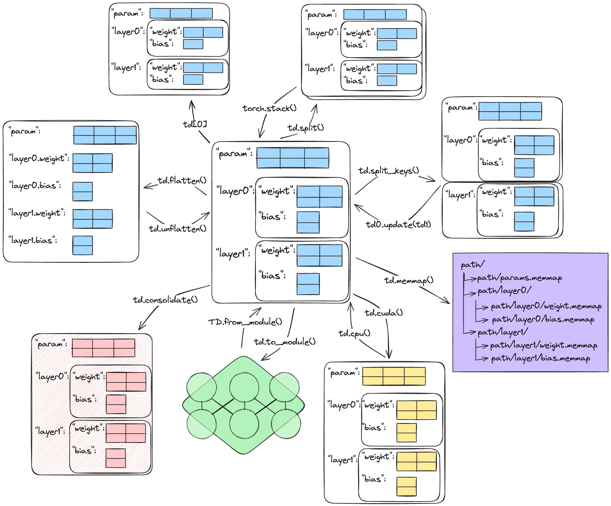

.. _getting-started:

Getting started
===============

This tour takes about one hour. It starts with your first
:class:`~tensordict.TensorDict` and ends with saving it and passing it to a
model. Each section links to the user guide page that gives the details.

All the examples run on a CPU. Run them in order in one Python session,
because later examples use names that earlier ones define. If tensordict is
not installed yet, read :ref:`installation` first.

         td[0], torch.stack, td.split, td.split_keys, td0.update(td1),
         td.memmap, td.cuda, td.cpu, td.to_module, TensorDict.from_module,
         td.consolidate, and flatten_keys.
   :width: 100%

   Common operations on one nested TensorDict. The two arrows on
   the left, labeled ``td.flatten()`` and ``td.unflatten()``, are
   :meth:`~tensordict.TensorDict.flatten_keys` and
   :meth:`~tensordict.TensorDict.unflatten_keys`.

Create a TensorDict
-------------------

A :class:`~tensordict.TensorDict` is a dictionary of tensors. Give it the
entries as a ``dict``. TensorDict converts NumPy arrays and ``int``, ``float``,
and ``bool`` values to :class:`torch.Tensor`:

  >>> import torch
  >>> from tensordict import TensorDict
  >>> td = TensorDict({"a": 0, "b": torch.ones(3)})
  >>> td
  TensorDict(batch_size=[], fields={a: i64[], b: f32[3]})
  >>> td["a"]
  tensor(0)

A TensorDict has the methods of a Python ``dict``: ``keys``, ``values``,
``items``, ``get``, ``update``, ``pop``, ``setdefault``, and others. Keys are
strings, or tuples of strings for nested entries.
:meth:`~tensordict.TensorDict.select` keeps some entries and
:meth:`~tensordict.TensorDict.exclude` removes them. Both return a new
TensorDict:

  >>> td["c"] = torch.zeros(2)
  >>> sorted(td.keys())
  ['a', 'b', 'c']
  >>> sorted(td.exclude("b").keys())
  ['a', 'c']
  >>> td.select("a", "c")["c"]
  tensor([0., 0.])

Batch size and batch dimensions
-------------------------------

Every TensorDict has a batch size, ``batch_size``: the leading dimensions that
all its tensors share. These dimensions are the batch dimensions. The tensors
of a TensorDict are its leaves. A leaf can have more dimensions after the
batch dimensions, and the leaves can have different dtypes. This TensorDict
holds 4 time steps of 3 sensors, with 5 channels for each reading:

  >>> data = TensorDict(
  ...     {
  ...         "reading": torch.ones(3, 4, 5),
  ...         "valid": torch.zeros(3, 4, dtype=torch.bool),
  ...     },
  ...     batch_size=[3, 4],
  ... )
  >>> data.batch_size
  torch.Size([3, 4])
  >>> data.shape
  torch.Size([3, 4])

``shape`` is another name for ``batch_size``. The first dimensions of each
tensor that you write must be equal to ``batch_size``. If they are not,
TensorDict raises a ``RuntimeError``:

  >>> data["offset"] = torch.zeros(2)
  Traceback (most recent call last):
  ...
  RuntimeError: batch dimension mismatch, got self.batch_size=torch.Size([3, 4]) and value.shape=torch.Size([2]) for key 'offset'. The leading dimensions of a value must match the batch size.

If you do not give ``batch_size``, it is ``torch.Size([])``: the TensorDict has
no batch dimensions. TensorDict does not infer the batch size from the
tensors. To infer it, use :meth:`~tensordict.TensorDict.from_dict` with
``auto_batch_size=True``, or call
:meth:`~tensordict.TensorDict.auto_batch_size_`. Both set the batch size to
the leading dimensions that all the leaves share:

  >>> TensorDict({"reading": torch.ones(3, 4, 5)}).batch_size
  torch.Size([])
  >>> TensorDict.from_dict(
  ...     {"reading": torch.ones(3, 4, 5), "valid": torch.zeros(3, 4)},
  ...     auto_batch_size=True,
  ... ).batch_size
  torch.Size([3, 4])

A TensorDict acts like a tensor, so some ``dict`` operations act on the batch
dimensions and not on the keys:

- ``for x in data`` gives the sub-TensorDicts along the first batch dimension,
  like a loop over a tensor. To iterate over the keys, use ``data.keys()``.
- ``len(data)`` is the size of the first batch dimension, ``data.batch_size[0]``.
- ``data[0]`` indexes the batch. An integer is never a key.
- ``bool(data)`` raises a ``RuntimeError``. To test for entries, use
  ``data.is_empty()``.
- ``"reading" in data`` tests the keys, as for a ``dict``.

For the ``data`` of this section:

  >>> len(data)
  3
  >>> [x.batch_size for x in data][0]
  torch.Size([4])
  >>> "reading" in data
  True

:ref:`batch-size` explains the batch size in detail.

Indexing and shape operations
-----------------------------

Indexing, slicing, and shape operations apply to the batch dimensions. They
return a new TensorDict, with the same operation applied to every leaf:

  >>> sub = data[..., :2]
  >>> sub.batch_size
  torch.Size([3, 2])
  >>> sub["reading"].shape
  torch.Size([3, 2, 5])
  >>> data[0, 1]["reading"].shape
  torch.Size([5])
  >>> data.reshape(-1).batch_size
  torch.Size([12])
  >>> data.unsqueeze(-1).batch_size
  torch.Size([3, 4, 1])
  >>> data.permute(1, 0)["reading"].shape
  torch.Size([4, 3, 5])

A boolean mask over the batch dimensions selects elements, as for a tensor:

  >>> mask = torch.tensor([True, False, True])
  >>> data[mask].batch_size
  torch.Size([2, 4])

To write into a part of a TensorDict, index it on the left of ``=``:

  >>> data[0] = TensorDict(
  ...     {
  ...         "reading": torch.zeros(4, 5),
  ...         "valid": torch.ones(4, dtype=torch.bool),
  ...     },
  ...     batch_size=[4],
  ... )
  >>> data["valid"][0]
  tensor([True, True, True, True])

:ref:`batch-size` covers indexing and the shape operations.

TensorClass: the class form
---------------------------

:class:`~tensordict.TensorClass` is the class form of a TensorDict. You
declare the fields as class annotations, like a dataclass, and you add your
own methods. A TensorClass has the tensor behavior of a TensorDict: the batch
size, indexing, shape operations, and the batch-size check. This class holds a
batch of images and their labels:

  >>> from tensordict import TensorClass
  >>> class Batch(TensorClass):
  ...     image: torch.Tensor
  ...     label: torch.Tensor
  ...
  ...     def select_label(self, label):
  ...         return self[self.label == label]
  >>> _ = torch.manual_seed(0)
  >>> images = Batch(
  ...     image=torch.randn(6, 3, 8, 8),
  ...     label=torch.tensor([0, 1, 0, 2, 1, 0]),
  ...     batch_size=[6],
  ... )
  >>> images.select_label(0).batch_size
  torch.Size([3])
  >>> type(images[0]).__name__
  'Batch'
  >>> images.reshape(2, 3).image.shape
  torch.Size([2, 3, 3, 8, 8])

Use a TensorDict when you do not know the keys in advance, and a
TensorClass for a fixed set of fields. Three other containers have the same
operations:

- :class:`~tensordict.TypedTensorDict` has typed fields on a
  ``TensorDictBase``, with ``td["key"]`` access and class inheritance to add
  fields. :ref:`typed-tensordict-guide` explains it.
- :class:`~tensordict.LazyStackedTensorDict` holds elements of different
  shapes. :func:`~tensordict.lazy_stack` makes one, as the stacking section
  below shows.
- :class:`~tensordict.PersistentTensorDict` reads its data from an HDF5 or
  Zarr file on disk.

:ref:`tensorclass-guide` explains TensorClass, and :ref:`choosing-a-container`
compares the containers.

Nested TensorDicts and tuple keys
---------------------------------

A TensorDict can contain other TensorDicts. A ``dict`` value becomes a nested
TensorDict with the batch size of its parent. To read or write a nested entry,
use a tuple of keys. In reinforcement learning, for example, a nested
``"next"`` entry holds the data of the next step:

  >>> data = TensorDict(
  ...     {
  ...         "obs": torch.ones(3, 4),
  ...         "next": {"obs": torch.zeros(3, 4)},
  ...     },
  ...     batch_size=[3],
  ... )
  >>> data["next"].batch_size
  torch.Size([3])
  >>> data["next", "obs"].shape
  torch.Size([3, 4])
  >>> data["next", "reward"] = torch.ones(3)
  >>> list(data.keys(include_nested=True, leaves_only=True))
  ['obs', ('next', 'obs'), ('next', 'reward')]

The ``batch_size`` of a nested TensorDict must start with the ``batch_size``
of its parent, and it can have more dimensions. For example, a child with
``batch_size=[3, 4]`` fits in a parent with ``batch_size=[3]``.

:meth:`~tensordict.TensorDict.flatten_keys` changes a nested TensorDict to one
level, with the keys joined by a separator.
:meth:`~tensordict.TensorDict.unflatten_keys` changes it back:

  >>> flat = data.flatten_keys(".")
  >>> sorted(flat.keys())
  ['next.obs', 'next.reward', 'obs']
  >>> sorted(flat.unflatten_keys(".").keys())
  ['next', 'obs']

:ref:`keys` explains nested keys and the methods that select and flatten
them.

Devices, dtypes, and arithmetic
-------------------------------

:meth:`~tensordict.TensorDict.to` moves or casts every leaf with one call. A
dtype casts every leaf, the integer and boolean ones too. If you set
``device`` when you create a TensorDict, TensorDict moves each tensor that
you write to that device:

  >>> device = "cuda" if torch.cuda.is_available() else "cpu"
  >>> data = TensorDict({"pos": torch.ones(3, 4), "step": torch.arange(3)}, batch_size=[3])
  >>> data.to(device)["pos"].device.type == device
  True
  >>> data.to(torch.float64)["step"].dtype
  torch.float64
  >>> on_device = TensorDict(batch_size=[3], device=device)
  >>> on_device["pos"] = torch.ones(3, 4)
  >>> on_device["pos"].device.type == device
  True

Arithmetic and most pointwise functions apply to every leaf. Between two
TensorDicts, they apply to the leaves with the same key:

  >>> (data * 2)["pos"][0]
  tensor([2., 2., 2., 2.])
  >>> (data + data)["step"]
  tensor([0, 2, 4])
  >>> data.abs()["pos"].shape
  torch.Size([3, 4])

If TensorDict has no method for an operation, use
:meth:`~tensordict.TensorDict.apply`. It calls a function on each leaf and
returns a new TensorDict. ``apply_`` writes the results into the same
TensorDict:

  >>> data.apply(lambda x: x.float().mean(-1) if x.ndim > 1 else x)["pos"]
  tensor([1., 1., 1.])

:ref:`devices` explains devices, dtypes, and ``non_blocking`` copies.
:ref:`operations` lists the arithmetic, reductions, and ``apply``.

Stacking and concatenation
--------------------------

:func:`torch.stack` and :func:`torch.cat` accept a list of TensorDicts. They
stack or concatenate each leaf, and add or extend a batch dimension:

  >>> samples = [
  ...     TensorDict({"features": torch.ones(4), "target": torch.zeros(())}, batch_size=[])
  ...     for _ in range(3)
  ... ]
  >>> batch = torch.stack(samples)
  >>> batch.batch_size
  torch.Size([3])
  >>> batch["features"].shape
  torch.Size([3, 4])
  >>> torch.cat([batch, batch]).batch_size
  torch.Size([6])

:func:`torch.stack` needs leaves with the same shape. For data of different
sizes, such as sentences or DNA reads of different lengths, use
:func:`~tensordict.lazy_stack`. It keeps the TensorDicts as a list, in a
:class:`~tensordict.LazyStackedTensorDict`, and stacks a leaf only when you
read it. To read a leaf with different shapes, ask for a list or a padded
tensor:

  >>> from tensordict import lazy_stack
  >>> ragged = lazy_stack([TensorDict({"tokens": torch.arange(n)}) for n in (2, 5)])
  >>> ragged.batch_size
  torch.Size([2])
  >>> ragged[1]["tokens"].shape
  torch.Size([5])
  >>> [x.shape for x in ragged.get("tokens", as_list=True)]
  [torch.Size([2]), torch.Size([5])]
  >>> ragged.get("tokens", as_padded_tensor=True).shape
  torch.Size([2, 5])

:ref:`stacking` explains lazy stacks and the other ways to store data of
different sizes.

Non-tensor data
---------------

A TensorDict can also hold values that are not tensors, such as strings.
Reading one returns the value:

  >>> data = TensorDict({"weight": torch.ones(3)}, batch_size=[3])
  >>> data["label"] = "cat"
  >>> data["label"]
  'cat'

TensorDict stores one value for the whole batch. Every element has that
value, so indexing keeps it:

  >>> data[0]["label"]
  'cat'

When you stack TensorDicts, the non-tensor values become a list:

  >>> pets = torch.stack([TensorDict({"label": "cat"}), TensorDict({"label": "dog"})])
  >>> list(pets["label"])
  ['cat', 'dog']

:ref:`non-tensor-data` explains how TensorDict stores these values, and how
they behave under indexing and stacking.

Save and load
-------------

:meth:`~tensordict.TensorDict.memmap` writes a TensorDict to a directory, with
one file for each leaf, and returns a memory-mapped copy.
:meth:`~tensordict.TensorDict.load_memmap` maps the files back into memory. It
reads the data from disk only when you use it.
:meth:`~tensordict.TensorDict.save` and :meth:`~tensordict.TensorDict.load`
are other names for the same two methods:

  >>> import tempfile
  >>> tmpdir = tempfile.TemporaryDirectory()
  >>> data = TensorDict(
  ...     {
  ...         "pos": torch.arange(6).reshape(3, 2),
  ...         "meta": TensorDict({"scale": torch.zeros(3, 2)}, batch_size=[3]),
  ...     },
  ...     batch_size=[3],
  ... )
  >>> _ = data.memmap(tmpdir.name)
  >>> loaded = TensorDict.load_memmap(tmpdir.name)
  >>> loaded.batch_size
  torch.Size([3])
  >>> loaded["pos"][1]
  MemoryMappedTensor([2, 3])
  >>> loaded["meta", "scale"].shape
  torch.Size([3, 2])
  >>> tmpdir.cleanup()

Tensors are stored without pickle. Non-tensor values that JSON cannot store
are stored with pickle, and ``load_memmap`` loads them only if you allow it
with ``allow_pickle``. :meth:`~tensordict.TensorDict.consolidate` copies all
the leaves into one storage. A device move or an inter-process transfer of
the result then copies one buffer.

:ref:`saving` compares ``memmap``, :func:`torch.save`, and ``state_dict``.
:ref:`storage` covers datasets that do not fit in memory.

Locking
-------

:meth:`~tensordict.TensorDict.lock_` locks a TensorDict. A locked TensorDict
does not accept new keys, and you cannot delete or replace an entry. You can
still write new values into the existing tensors with
:meth:`~tensordict.TensorDict.set_` and :meth:`~tensordict.TensorDict.update_`.
These methods copy the values into the same storage, or replace the value of
a non-tensor entry:

  >>> data = TensorDict({"pos": torch.zeros(3)}, batch_size=[3]).lock_()
  >>> data["vel"] = torch.ones(3)
  Traceback (most recent call last):
  ...
  RuntimeError: Cannot modify locked TensorDict. For in-place modification, consider using the `set_()` method and make sure the key is present.
  >>> _ = data.set_("pos", torch.ones(3))
  >>> data["pos"]
  tensor([1., 1., 1.])

``memmap`` and ``consolidate`` return a locked TensorDict.
:meth:`~tensordict.TensorDict.unlock_` unlocks it. To unlock a TensorDict for
some lines only, use ``unlock_`` as a context manager:

  >>> with data.unlock_():
  ...     data["vel"] = torch.ones(3)
  >>> data.is_locked
  True

:ref:`keys` explains locking and the other context managers.
:ref:`inplace-conventions` explains which methods write into the same storage.

TensorDict and modules
----------------------

:meth:`~tensordict.TensorDict.from_module` puts the parameters and buffers of
a :class:`torch.nn.Module` in a TensorDict, with the structure of the module.
:meth:`~tensordict.TensorDict.to_module` puts them back. As a context
manager, ``to_module`` sets other values for some lines only, and then
restores the original parameters:

  >>> from torch import nn
  >>> model = nn.Sequential(nn.Linear(3, 4), nn.Linear(4, 2))
  >>> params = TensorDict.from_module(model)
  >>> params["0", "weight"].shape
  torch.Size([4, 3])
  >>> zeros = params.detach().clone().zero_()
  >>> with zeros.to_module(model):
  ...     out = model(torch.ones(3))
  >>> out
  tensor([0., 0.], grad_fn=<ViewBackward0>)

Each leaf has its own file, so you can save the parameters with ``memmap``
and load the parameters of one submodule only, from its subdirectory. To
load memory-mapped parameters into a model, pass ``inplace=True``.
``to_module`` then copies the values into the parameters of the model:

  >>> tmpdir = tempfile.TemporaryDirectory()
  >>> _ = params.memmap(tmpdir.name)
  >>> _ = TensorDict.load_memmap(tmpdir.name).to_module(model, inplace=True)
  >>> _ = TensorDict.load_memmap(f"{tmpdir.name}/0").to_module(model[0], inplace=True)
  >>> tmpdir.cleanup()

Without ``inplace=True``, the parameters of the model use the memory-mapped
files as their storage. A change to a parameter, for example an optimizer
step, can then change the files (:ref:`saving` explains when).

:class:`~tensordict.nn.TensorDictModule` wraps a module so that it reads its
inputs from a TensorDict and writes its outputs into the same TensorDict.
``in_keys`` and ``out_keys`` name the entries.
:class:`~tensordict.nn.TensorDictSequential` chains such modules:

  >>> from tensordict.nn import TensorDictModule, TensorDictSequential
  >>> net = TensorDictSequential(
  ...     TensorDictModule(nn.Linear(3, 8), in_keys=["features"], out_keys=["hidden"]),
  ...     TensorDictModule(nn.Linear(8, 2), in_keys=["hidden"], out_keys=["logits"]),
  ... )
  >>> batch = TensorDict({"features": torch.randn(4, 3)}, batch_size=[4])
  >>> _ = net(batch)
  >>> batch["logits"].shape
  torch.Size([4, 2])

The model and the loss read and write the same TensorDict, so one training
loop works for data with different keys. :ref:`modules-guide` explains
``tensordict.nn``. :ref:`compile` covers ``torch.compile`` and
``torch.vmap`` with parameter TensorDicts.

Next steps
----------

- The user guide explains each idea of this page in detail. Start with
  :ref:`overview`.
- The tutorials are scripts that you can run. Start with
  :doc:`tutorials/tensordict_keys`, then :doc:`tutorials/tensordict_slicing`
  and :doc:`tutorials/tensordict_shapes`.
- The how-to guides solve one task each: :ref:`saving`, :ref:`storage`,
  :ref:`data-loading`, :ref:`distributed`, and :ref:`compile`.
- :ref:`api-reference` lists every class and method.
