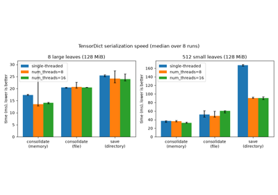

# TensorDictBase.consolidate

TensorDictBase.consolidate(*filename: [Path](https://docs.python.org/3/library/pathlib.html#pathlib.Path) | [str](https://docs.python.org/3/builtins/stdtypes.html#str) | [None](https://docs.python.org/3/builtins/constants.html#None) = None*, ***, *num_threads=0*, *device: [device](https://docs.pytorch.org/docs/stable/tensor_attributes.html#torch.device) | [None](https://docs.python.org/3/builtins/constants.html#None) = None*, *non_blocking: [bool](https://docs.python.org/3/builtins/functions.html#bool) = False*, *inplace: [bool](https://docs.python.org/3/builtins/functions.html#bool) = False*, *return_early: [bool](https://docs.python.org/3/builtins/functions.html#bool) = False*, *use_buffer: [bool](https://docs.python.org/3/builtins/functions.html#bool) = False*, *share_memory: [bool](https://docs.python.org/3/builtins/functions.html#bool) = False*, *pin_memory: [bool](https://docs.python.org/3/builtins/functions.html#bool) = False*, *metadata: [bool](https://docs.python.org/3/builtins/functions.html#bool) = False*) → [None](https://docs.python.org/3/builtins/constants.html#None)

Copies all the leaves into one contiguous storage, and returns a tensordict of views of it.

A consolidated tensordict pickles and moves between devices faster,
because its leaves are one block of memory: [`to()`](tensordict.TensorDictBase.to.html#tensordict.TensorDictBase.to),
[`pickle`](https://docs.python.org/3/library/pickle.html#module-pickle), [`send()`](tensordict.TensorDictBase.send.html#tensordict.TensorDictBase.send) and [`broadcast()`](tensordict.TensorDictBase.broadcast.html#tensordict.TensorDictBase.broadcast) move that block
in one copy. The result is locked (see [Locking and temporary changes](../../concepts/keys.html#keys-locking)): you can
write into its leaves in place, but you cannot add or remove entries.

If the tensordict is already consolidated, `self` is returned and
the other arguments are ignored, except `pin_memory=True`: a
storage on the CPU that is not pinned is then copied into a pinned
one, and a new tensordict is returned, unless `filename`,
`inplace=True`, `return_early=True` with `num_threads > 1` or a
`device` other than the CPU is given, or no accelerator is
available. A `filename` other than its own
file writes nothing and emits a [`UserWarning`](https://docs.python.org/3/builtins/exceptions.html#UserWarning):
`td.contiguous().consolidate(filename=other)` writes a new file. A
`device` other than the one of the storage, and
`share_memory=True` with a storage that is not in shared memory,
are ignored with a [`UserWarning`](https://docs.python.org/3/builtins/exceptions.html#UserWarning):
`td.contiguous().consolidate(...)` copies the storage into a new one
and honours them.

Parameters:

**filename** ([*str*](https://docs.python.org/3/builtins/stdtypes.html#str)*or**Path**,**optional*) - a file to use as the storage. The
leaves are views into a memory map of the file, and the
metadata is written after them, so that
[`from_consolidated()`](tensordict.TensorDictBase.from_consolidated.html#tensordict.TensorDictBase.from_consolidated) can read the file back. Defaults to
`None`, which keeps the storage in memory.

Keyword Arguments:

- **num_threads** ([*int*](https://docs.python.org/3/builtins/functions.html#int)*,**optional*) - the number of threads that copy the
leaves into the storage, by chunks of about equal size. When
`filename` is given, `return_early=False` and all the
leaves are on the CPU, one copy is faster and `num_threads`
is ignored. Defaults to `0`, which copies in the calling
thread.
- **device** ([*device*](https://docs.pytorch.org/docs/stable/tensor_attributes.html#torch.device)*,*[*str*](https://docs.python.org/3/builtins/stdtypes.html#str)*or*[*int*](https://docs.python.org/3/builtins/functions.html#int)*,**optional*) - the device of the
storage. Exclusive with `filename`, unless it is `"cpu"`.
Defaults to `None`, which uses the device of the tensordict,
or the CPU if it has none.
- **non_blocking** ([*bool*](https://docs.python.org/3/builtins/functions.html#bool)*,**optional*) - if `True`, copies between devices
can run asynchronously with respect to the host. Defaults to
`False`.
- **inplace** ([*bool*](https://docs.python.org/3/builtins/functions.html#bool)*,**optional*) - if `True`, the leaves of the tensordict
are replaced by the views, and `self` is returned. Defaults
to `False`.
- **return_early** ([*bool*](https://docs.python.org/3/builtins/functions.html#bool)*,**optional*) - if `True` and `num_threads > 1`,
returns a [`TensorDictFuture`](tensordict.utils.TensorDictFuture.html#tensordict.utils.TensorDictFuture) at once,
while the threads copy the leaves: `future.result()` waits
for them and returns the tensordict. Not supported with
`use_buffer=True` or `non_blocking=True`. Defaults to
`False`.
- **use_buffer** ([*bool*](https://docs.python.org/3/builtins/functions.html#bool)*,**optional*) - if `True` and `filename` is given,
the leaves are copied into a buffer in shared memory, which is
written to the file at the end. This can be faster on a remote
file system (for example NFS). In-place writes into the leaves
then do not reach the file. Defaults to `False`.
- **share_memory** ([*bool*](https://docs.python.org/3/builtins/functions.html#bool)*,**optional*) - if `True`, the storage is placed
in shared memory. Defaults to `False`.
- **pin_memory** ([*bool*](https://docs.python.org/3/builtins/functions.html#bool)*,**optional*) - if `True`, the storage is placed in
pinned memory. Defaults to `False`.
- **metadata** ([*bool*](https://docs.python.org/3/builtins/functions.html#bool)*,**optional*) - if `True`, the structure of the
tensordict is stored with the storage, which changes how the
result is pickled; [`send()`](tensordict.TensorDictBase.send.html#tensordict.TensorDictBase.send) and [`init_remote()`](tensordict.TensorDictBase.init_remote.html#tensordict.TensorDictBase.init_remote) use
it. It is always stored when `filename` is given. Defaults to
`False`.

Returns:

A consolidated tensordict, `self` if `inplace=True`, or a
[`TensorDictFuture`](tensordict.utils.TensorDictFuture.html#tensordict.utils.TensorDictFuture) of it if
`return_early=True` and `num_threads > 1`.

Note

The file written with `filename` holds the batch sizes and names
at the time of the call. Setting `batch_size` or `names` on the
result later does not change the file: call
`consolidate(filename=filename)` again on the result to write
them. Likewise, a pickle of the result is rebuilt from metadata
recorded here: setting the batch size of a nested tensordict, as in
`td["nested"].batch_size = ...`, may not update it until
`consolidate()` is called again.

Examples

```
>>> import pickle
>>> import torch
>>> from tensordict import TensorDict
>>> data = TensorDict({"a": torch.zeros(()), "b": {"c": torch.zeros(())}})
>>> data_consolidated = data.consolidate()
>>> # All the leaves share one storage.
>>> assert torch.tensor([
... v.untyped_storage().data_ptr() for v in data_consolidated.values(True, True)
... ]).unique().numel() == 1
>>> data_consolidated.is_consolidated(), data_consolidated.is_locked
(True, True)
>>> # A consolidated tensordict pickles as one buffer.
>>> restored = pickle.loads(pickle.dumps(data_consolidated))
>>> (restored == data).all()
True
```

Every tensordict class and every tensorclass has this method. For the
other methods, see [Methods by task](../td.html#api-tensordict-methods).

## Tutorials that use `consolidate`



[Benchmarking TensorDict serialization speed](../../tutorials/serialization_speed.html)

Benchmarking TensorDict serialization speed