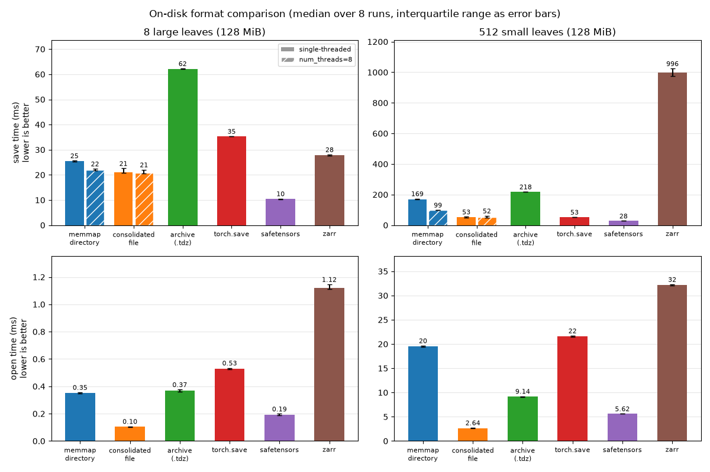

# Save and load tensordicts

[`save()`](reference/generated/tensordict.TensorDictBase.save.html#tensordict.TensorDictBase.save) writes each tensor of a tensordict
(each *leaf*) to its own file, in a directory tree that follows the keys.
[`load_memmap()`](reference/generated/tensordict.TensorDictBase.load_memmap.html#tensordict.TensorDictBase.load_memmap) maps the files back into
memory, and reads a leaf from disk only when you use it. Here, one call saves
the state of 100 particles:

```
>>> import tempfile
>>> from pathlib import Path
>>> import torch
>>> from tensordict import TensorDict
>>> tmp = tempfile.TemporaryDirectory()
>>> root = Path(tmp.name)
>>> particles = TensorDict(
... {"pos": torch.zeros(100, 3), "vel": torch.ones(100, 3)}, batch_size=[100]
... )
>>> _ = particles.save(root / "particles")
>>> loaded = TensorDict.load_memmap(root / "particles")
>>> loaded[0]["vel"]
MemoryMappedTensor([1., 1., 1.])
```

The examples on this page run in order, and share the temporary directory
`root`.

## Choose a format

| To do this | Use | Section |
| --- | --- | --- |
| Save a model checkpoint, then load all of it or one sub-module | [`save()`](reference/generated/tensordict.TensorDictBase.save.html#tensordict.TensorDictBase.save), [`load_memmap()`](reference/generated/tensordict.TensorDictBase.load_memmap.html#tensordict.TensorDictBase.load_memmap) | Save a checkpoint |
| Give the data to someone as one file that loads lazily | `td.save("data.tdz")` | Single-file archives |
| Open or pickle the data in the shortest time | [`consolidate()`](reference/generated/tensordict.TensorDictBase.consolidate.html#tensordict.TensorDictBase.consolidate), [`from_consolidated()`](reference/generated/tensordict.from_consolidated.html#tensordict.from_consolidated) | Consolidated files |
| Give the file to code that reads safetensors, such as the Hugging Face libraries, or load a safetensors checkpoint | [`to_safetensors()`](reference/generated/tensordict.to_safetensors.html#tensordict.to_safetensors), [`from_safetensors()`](reference/generated/tensordict.from_safetensors.html#tensordict.from_safetensors) | Safetensors files |
| Give the file to code that calls [`torch.load()`](https://docs.pytorch.org/docs/stable/generated/torch.load.html#torch.load) | [`torch.save()`](https://docs.pytorch.org/docs/stable/generated/torch.save.html#torch.save) | torch.save and torch.load |
| Give the tensors to code that expects a flat state dict | [`state_dict()`](reference/generated/tensordict.TensorDictBase.state_dict.html#tensordict.TensorDictBase.state_dict) | state_dict and load_state_dict |
| Load a file that you did not write | `allow_pickle`, `weights_only` | Load data that you did not write |
| Add rows to the end of a saved dataset | [`append_memmap()`](reference/generated/tensordict.append_memmap.html#tensordict.append_memmap) | Append rows |
| Preallocate a dataset on disk and fill it one sample at a time | [`memmap_like()`](reference/generated/tensordict.TensorDictBase.memmap_like.html#tensordict.TensorDictBase.memmap_like), [`from_schema()`](reference/generated/tensordict.TensorDictBase.from_schema.html#tensordict.TensorDictBase.from_schema) | [Large datasets and storage backends](storage.html#storage) |
| Store chunked, compressed, or remote data (HDF5, zarr, Redis) | [`PersistentTensorDict`](reference/generated/tensordict.PersistentTensorDict.html#tensordict.PersistentTensorDict), [`TensorDictStore`](reference/generated/tensordict.store.TensorDictStore.html#tensordict.store.TensorDictStore) | [Large datasets and storage backends](storage.html#storage) |

## Save a checkpoint

To save a model, collect its parameters and buffers with
[`from_module()`](reference/generated/tensordict.TensorDictBase.from_module.html#tensordict.TensorDictBase.from_module). The result has one nested
tensordict for each sub-module:

```
>>> from torch import nn
>>> _ = torch.manual_seed(0)
>>> model = nn.Sequential(nn.Linear(3, 4), nn.ReLU(), nn.Linear(4, 2))
>>> params = TensorDict.from_module(model)
>>> _ = params.save(root / "checkpoint")
>>> sorted(p.name for p in (root / "checkpoint").iterdir())
['0', '2', 'meta.json']
```

To load the checkpoint into a model, read it with `load_memmap`, and call
[`to_module()`](reference/generated/tensordict.TensorDictBase.to_module.html#tensordict.TensorDictBase.to_module) with `inplace=True`. It copies
each value into the existing parameter of the model, so the parameters stay
[`Parameter`](https://docs.pytorch.org/docs/stable/generated/torch.nn.parameter.Parameter.html#torch.nn.parameter.Parameter) instances in memory:

```
>>> new_model = nn.Sequential(nn.Linear(3, 4), nn.ReLU(), nn.Linear(4, 2))
>>> loaded = TensorDict.load_memmap(root / "checkpoint")
>>> _ = loaded.to_module(new_model, inplace=True)
>>> torch.equal(new_model[0].weight, model[0].weight)
True
```

The loaded leaves are [`MemoryMappedTensor`](reference/generated/tensordict.MemoryMappedTensor.html#tensordict.MemoryMappedTensor) instances.
Without `inplace=True`, `to_module` makes a new parameter from each of
them, and the new parameter uses the file as its storage. If the files are
mapped as shared (`mode="r+"`, the default for a directory that you can
write), a change to the parameter, for example an optimizer step, changes
the checkpoint on disk.

To load one sub-module, pass its key as `subpath`. tensordict then reads
only that part of the tree. `subpath` takes a nested key, such as
`("encoder", "0")`, or a path, such as `"encoder/0"`:

```
>>> last_layer = TensorDict.load_memmap(root / "checkpoint", subpath="2")
>>> _ = last_layer.to_module(new_model[2], inplace=True)
>>> last_layer["weight"].shape
torch.Size([2, 4])
```

To read the keys, shapes, and dtypes of a checkpoint without its data, load
it on the `"meta"` device:

```
>>> TensorDict.load_memmap(root / "checkpoint", device="meta")["0", "weight"]
tensor(..., device='meta', size=(4, 3))
```

## Options of save and load_memmap

The methods have several names:

- [`save()`](reference/generated/tensordict.TensorDictBase.save.html#tensordict.TensorDictBase.save),
[`dumps()`](reference/generated/tensordict.TensorDictBase.dumps.html#tensordict.TensorDictBase.dumps), and
[`memmap()`](reference/generated/tensordict.TensorDictBase.memmap.html#tensordict.TensorDictBase.memmap) are one method. They return a
new tensordict with memory-mapped leaves.
- [`memmap_()`](reference/generated/tensordict.TensorDictBase.memmap_.html#tensordict.TensorDictBase.memmap_) writes the same files, and
replaces the leaves of the tensordict itself.
- [`load()`](reference/generated/tensordict.TensorDictBase.load.html#tensordict.TensorDictBase.load) and
[`load_memmap()`](reference/generated/tensordict.TensorDictBase.load_memmap.html#tensordict.TensorDictBase.load_memmap) are one method.

`memmap`, `memmap_`, and `save` lock the tensordict that they return,
except when `memmap` or `save` writes a `.tdz` archive.
You can write into its tensors in place, but you cannot add, remove, or
replace an entry (see [Locking and temporary changes](concepts/keys.html#keys-locking)).

To write several files at the same time, pass `num_threads`. Threads make
the save faster when the tensordict has a few large leaves, and slower when
it has many small ones. In one measurement, `num_threads=4` saved the
weights of [`torch.nn.Transformer`](https://docs.pytorch.org/docs/stable/generated/torch.nn.Transformer.html#torch.nn.Transformer) (184 leaves, 168 MiB) 1.6 times as
fast as one thread, and saved 2000 small leaves 3 times as slowly. Measure
both on your data.

A job that is killed while it saves to a directory leaves some files new,
some old, and some truncated. To avoid this, pass `atomic=True`: the files
are written to a new directory next to the path, which then replaces the old
one in two renames. Readers see the old or the new directory, except between
the two renames, when the path is missing: if the job is killed then, the
old directory is in `.tdtmp-*/old` next to the path. The save needs about
twice the disk space while it runs. It is not supported on Windows, which
cannot rename a directory that holds open files. A `.tdz` archive is always
written this way.

```
>>> _ = TensorDict({"a": torch.zeros(3)}, batch_size=[3]).save(root / "ckpt", atomic=True)
>>> TensorDict.load_memmap(root / "ckpt")["a"]
MemoryMappedTensor([0., 0., 0.])
```

If you do not give a path, `memmap` and `memmap_` put each tensor in an
anonymous temporary file. On Linux, the file is in shared memory
(`/dev/shm`) if it has room. The file has no name, so `load_memmap`
cannot read it, and the data disappears when the process ends. Use this to
share data between processes (see [Load data and share it between processes](data_loading.html#data-loading)).

### Tensors that already have a file

If a leaf is already a memory-mapped tensor, `memmap` without a path keeps
the same tensor:

```
>>> td = TensorDict({"a": 1}, [])
>>> td0 = td.memmap()
>>> td1 = td0.memmap()
>>> td0["a"] is td1["a"]
True
```

If you give another path, `memmap` raises an error, so that you do not copy
a large file by accident. To copy the file, pass `copy_existing=True`:

```
>>> td0 = td.memmap(root / "first")
>>> td1 = td0.memmap(root / "second")
Traceback (most recent call last):
...
RuntimeError: A filename was provided but the tensor already has a file associated (...). To copy the tensor onto the new location, pass copy_existing=True.
>>> td1 = td0.memmap(root / "second", copy_existing=True)
>>> TensorDict.load_memmap(root / "second")["a"]
MemoryMappedTensor(1)
```

### Write to the files after you load them

The `mode` argument of `load_memmap` sets where an in-place change to a
loaded tensor goes:

- Default (`mode=None`): if the process can write the file, in-place
writes go to the file. If it cannot, the file loads as with `"r"`.
- `mode="r"`: the files are mapped copy-on-write. In-place writes stay in
memory, and the files do not change.
- `mode="r+"`: in-place writes go to the files. If a file is not writable,
`load_memmap` raises a `PermissionError`.

Here, the reader with `mode="r"` changes memory only, and the writer with
the default mode changes the file:

```
>>> _ = TensorDict({"a": torch.zeros(3)}, batch_size=[3]).save(root / "data")
>>> reader = TensorDict.load_memmap(root / "data", mode="r")
>>> _ = reader["a"].add_(1)
>>> TensorDict.load_memmap(root / "data")["a"]
MemoryMappedTensor([0., 0., 0.])
>>> writer = TensorDict.load_memmap(root / "data")
>>> _ = writer["a"].add_(1)
>>> TensorDict.load_memmap(root / "data")["a"]
MemoryMappedTensor([1., 1., 1.])
```

If many nodes read the same files on a network file system, load with
`mode="r"`. On some of these file systems (for example Lustre), a page
fault on a shared writable mapping takes a write lock. Readers on
different nodes then block each other. On Linux, a copy-on-write mapping
counts against the memory commit limit. If a file is larger than RAM plus
swap, `mode="r"` can fail to map it. In that case, use the default mode.

## Append rows

[`append_memmap()`](reference/generated/tensordict.append_memmap.html#tensordict.append_memmap) grows a saved directory along its first
batch dimension. It writes the new rows at the end of each leaf file, and
then updates the `meta.json` files. Here, 20 particles join the 100 of the
first example:

```
>>> import tensordict
>>> more = TensorDict(
... {"pos": torch.ones(20, 3), "vel": torch.ones(20, 3)}, batch_size=[20]
... )
>>> tensordict.append_memmap(root / "particles", more)
>>> TensorDict.load_memmap(root / "particles").batch_size
torch.Size([120])
```

The rows must have the keys, the classes, the dtypes and the trailing shapes
of the saved data. `append_memmap` checks this before it writes anything,
and raises an error if they differ. A non-tensor value, such as a string, is
saved once for all the rows, so the rows must hold the same value, either
once or in a stack of equal values. The files
of a lazy stack, a [`NonTensorStack`](reference/generated/tensordict.NonTensorStack.html#tensordict.NonTensorStack), a nested tensor, or
an archive cannot grow, and `append_memmap` raises an error for them.

`append_memmap` replaces each `meta.json` file last, so a failed append
leaves the data as it was. A tensordict loaded before the append keeps its
number of rows, and `load_memmap` after the append sees the new rows.
Append from one process at a time.

The `meta.json` files of nested levels are replaced one at a time, so an
append that is killed midway, or a `load_memmap` that runs during an
append, can see nested levels with different numbers of rows. Don't read a
directory while you append to it.

A killed append can leave its new `meta.json` files behind, as
`.meta.json.append.tmp` files next to the old ones. If it was killed after
the first `meta.json` was replaced, `load_memmap` raises an error, and so
does the next `append_memmap`. Every temporary file is then complete.
Rename each one over the `meta.json` next to it, which completes the
append:

```
import os

for tmp in (root / "particles").rglob(".meta.json.append.tmp"):
 os.replace(tmp, tmp.with_name("meta.json"))
```

If the directory still loads, delete the leftover `.meta.json.append.tmp`
files instead, as they may be incomplete.

## Save to one file

A directory has one file for each leaf. To write one file instead, use an
archive, a consolidated file, or [`torch.save()`](https://docs.pytorch.org/docs/stable/generated/torch.save.html#torch.save):

| Format | Write, then read | Lazy load | Load one sub-tree | Use it to |
| --- | --- | --- | --- | --- |
| Archive (`.tdz`) | `td.save("x.tdz")`, `TensorDict.load_memmap("x.tdz")` | Yes | Yes (`subpath`) | Give a checkpoint or a dataset to other people, or copy it to a network file system |
| Consolidated file | `td.consolidate("x.bin")`, `from_consolidated("x.bin")` | Yes | No | Open the data in the shortest time |
| safetensors | `to_safetensors(td, "x.safetensors")`, `from_safetensors("x.safetensors")` | No | No | Give the data to code that reads safetensors |
| `torch.save` | `torch.save(td, "x.pt")`, `torch.load("x.pt")` | With `torch.load(..., mmap=True)` | No | Give the data to code that calls `torch.load` |

### Single-file archives

If the path ends with `".tdz"`, or if you pass `archive=True`,
[`save()`](reference/generated/tensordict.TensorDictBase.save.html#tensordict.TensorDictBase.save) (and `memmap` and `dumps`) writes
one file instead of a directory. This example saves a triangle mesh with a
temperature field on its vertices:

```
>>> mesh = TensorDict(
... {
... "vertices": torch.rand(10, 3),
... "faces": torch.randint(10, (16, 3)),
... "fields": {"temperature": torch.rand(10)},
... },
... )
>>> _ = mesh.save(root / "mesh.tdz")
>>> loaded = TensorDict.load_memmap(root / "mesh.tdz")
>>> (loaded == mesh).all()
True
```

The archive is a standard zip file. Its entries are the files of the
directory tree (the `meta.json` files and the `*.memmap` tensor files).
The tensor payloads are aligned and not compressed, so `load_memmap` maps
the archive once and makes each leaf a view into the mapping. Apart from
the metadata, tensordict reads a tensor from disk only when you use it.

Because the entries are the directory tree, you can convert an archive to a
directory and back, with [`pack_memmap()`](reference/generated/tensordict.pack_memmap.html#tensordict.pack_memmap) and
[`unpack_memmap()`](reference/generated/tensordict.unpack_memmap.html#tensordict.unpack_memmap) or with any zip tool:

```
unzip data.tdz -d data_dir # gives a directory that load_memmap reads
(cd data_dir && zip -0 -r ../data.zip .) # gives an archive that load_memmap reads
```

`subpath` works as with a directory. tensordict then reads only that part
of the archive:

```
>>> TensorDict.load_memmap(root / "mesh.tdz", subpath="fields")["temperature"].shape
torch.Size([10])
```

An archive loads differently from a directory in two ways:

- By default, the leaves are views into one storage, as with
[`from_consolidated()`](reference/generated/tensordict.from_consolidated.html#tensordict.from_consolidated). In-place writes change memory only,
not the file. To write to the file, load with `mode="r+"`.
- An archive made by another zip tool loads correctly. If a payload is not
aligned, tensordict copies that leaf into memory instead of making a view.

This example writes zeros to the archive through `mode="r+"`:

```
>>> mesh_rw = TensorDict.load_memmap(root / "mesh.tdz", mode="r+")
>>> _ = mesh_rw["vertices"].zero_()
>>> TensorDict.load_memmap(root / "mesh.tdz")["vertices"].sum()
tensor(0.)
```

An in-place write does not update the CRC-32 checksum that the zip format
stores for each entry. `load_memmap` does not read the checksums. Before
you give a changed archive to a tool that reads them, such as `unzip` or
[`unpack_memmap()`](reference/generated/tensordict.unpack_memmap.html#tensordict.unpack_memmap), call
[`refresh_archive_checksums()`](reference/generated/tensordict.refresh_archive_checksums.html#tensordict.refresh_archive_checksums):

```
>>> from tensordict import refresh_archive_checksums
>>> _ = refresh_archive_checksums(root / "mesh.tdz")
```

To compress an archive, pass `compression="deflate"`, `"bzip2"`, or
`"lzma"`. tensordict cannot memory-map a compressed leaf. It decompresses
the leaf into memory the first time you use it, and `mode="r+"` raises an
error. Use compression for archival storage. `uint8` images and boolean
masks compress well, and float weights do not.

### Consolidated files

[`consolidate()`](reference/generated/tensordict.TensorDictBase.consolidate.html#tensordict.TensorDictBase.consolidate) copies all the leaves into one
contiguous storage, and makes each leaf a view into it. With a file name, the
storage is a memory-mapped file. [`from_consolidated()`](reference/generated/tensordict.from_consolidated.html#tensordict.from_consolidated) opens
the file again. This example saves a graph with four nodes and three edges:

```
>>> from tensordict import from_consolidated
>>> graph = TensorDict(
... {
... "nodes": torch.zeros(4, 8),
... "edges": {"index": torch.tensor([[0, 1, 2], [1, 2, 3]]), "weight": torch.ones(3)},
... },
... )
>>> graph_c = graph.consolidate(root / "graph.bin")
>>> from_consolidated(root / "graph.bin")["edges", "index"]
tensor([[0, 1, 2],
 [1, 2, 3]])
```

The file keeps the batch sizes and names that the tensordict had when
`consolidate` wrote it. If you change them on `graph_c` later, call
`graph_c.consolidate(root / "graph.bin")` again to write them into the file.

`consolidate` returns a locked tensordict. If you unlock it with
[`unlock_()`](reference/generated/tensordict.TensorDictBase.unlock_.html#tensordict.TensorDictBase.unlock_), it is no longer consolidated:

```
>>> graph_c.is_locked, graph_c.is_consolidated()
(True, True)
>>> graph_c.unlock_().is_consolidated()
False
```

A consolidated tensordict also pickles faster, because pickle gets one
storage instead of one tensor for each leaf. In one measurement, pickling a
tensordict with 1000 small leaves took 34 ms, and 0.3 ms once consolidated
(`consolidate()` itself took 9 ms). [Distributed tensordicts](distributed.html#distributed) uses the same
layout to send a tensordict as one message. See
[`consolidate()`](reference/generated/tensordict.TensorDictBase.consolidate.html#tensordict.TensorDictBase.consolidate) for its other options
(`num_threads`, `device`, `pin_memory`, `share_memory`).

### Safetensors files

safetensors is the format of most model weights on the Hugging Face Hub. A
safetensors file maps names to tensors, and has no pickle.
[`to_safetensors()`](reference/generated/tensordict.to_safetensors.html#tensordict.to_safetensors) saves each tensor under its nested key
joined with `"."`, the name that a model's `state_dict` gives it, and
[`from_safetensors()`](reference/generated/tensordict.from_safetensors.html#tensordict.from_safetensors) loads the file. You need the
`safetensors` package (`pip install "tensordict[safetensors]"`):

```
>>> from tensordict import from_safetensors, to_safetensors
>>> to_safetensors(params, root / "model.safetensors")
>>> from safetensors.torch import load_file
>>> sorted(load_file(root / "model.safetensors"))
['0.bias', '0.weight', '2.bias', '2.weight']
>>> loaded = from_safetensors(root / "model.safetensors")
>>> _ = loaded.to_module(new_model, inplace=True)
```

`to_safetensors` also writes the structure of the tensordict in the
metadata of the file, as one JSON string: the batch size and dim names of
each level, the class of each tensorclass, and the non-tensor values. So
`from_safetensors` gives back the tensordict that you saved, also for keys
that contain `"."`:

```
>>> from tensordict import NonTensorData
>>> trial = TensorDict(
... {"x": torch.zeros(3), "config": NonTensorData({"lr": 0.1}), "a.b": {"c": torch.ones(3)}},
... batch_size=[3],
... )
>>> to_safetensors(trial, root / "trial.safetensors")
>>> loaded = from_safetensors(root / "trial.safetensors")
>>> loaded["config"], loaded["a.b"].batch_size
({'lr': 0.1}, torch.Size([3]))
```

A file without this metadata, such as a checkpoint from the Hub, loads as a
nested [`TensorDict`](reference/generated/tensordict.TensorDict.html#tensordict.TensorDict) with an empty batch size: each name
is split on `"."`. Pass `device` to load the tensors on a device.

safetensors holds dense tensors only. `to_safetensors` raises an error for
a nested or jagged tensor, for a non-tensor value that JSON cannot represent
exactly (only `str`, `int`, `float`, `bool`, `None`, `list`, and
`dict` with string keys), for a stack of non-tensor values, and for a lazy
stack whose entries have different keys. To save a lazy stack whose entries
have different shapes, pad them first, for example with
[`pad_sequence()`](reference/generated/tensordict.pad_sequence.html#tensordict.pad_sequence). Tensors that share memory, such as
tied weights, are saved as separate copies, and load as separate tensors.

To load a tensorclass, import the module that defines it first.
`from_safetensors` never imports a module by the name in a file. The class
is matched by its full name, so a tensorclass defined in a script
(`__main__`) loads only in a script that defines it too.

## torch.save and torch.load

[`torch.load()`](https://docs.pytorch.org/docs/stable/generated/torch.load.html#torch.load) reads a tensordict that [`torch.save()`](https://docs.pytorch.org/docs/stable/generated/torch.save.html#torch.save) wrote, with
`weights_only=True` (the default since PyTorch 2.6). When you import
tensordict, it allowlists the classes and functions that these files
reference, with [`torch.serialization.add_safe_globals()`](https://docs.pytorch.org/docs/stable/notes/serialization.html#torch.serialization.add_safe_globals). The list covers
[`TensorDict`](reference/generated/tensordict.TensorDict.html#tensordict.TensorDict), [`LazyStackedTensorDict`](reference/generated/tensordict.LazyStackedTensorDict.html#tensordict.LazyStackedTensorDict),
consolidated tensordicts, non-tensor values made of Python builtins, such
as strings, numbers, lists, and dicts, and the `torch.return_types` that
`max(dim=...)`, `min(dim=...)`, `cummax` and `cummin` return:

```
>>> batch = TensorDict({"loss": torch.zeros(3), "meta": {"split": "train"}}, batch_size=[3])
>>> torch.save(batch, root / "batch.pt")
>>> torch.load(root / "batch.pt", weights_only=True)["meta", "split"]
'train'
```

The list does not include tensorclasses, or the types of other non-tensor
values, such as NumPy arrays or dates. For these, loading stops with an
`Unsupported global` error that names the missing class or function:

```
>>> import datetime
>>> from tensordict import NonTensorData
>>> td = TensorDict({"date": NonTensorData(datetime.date(2024, 1, 1))})
>>> torch.save(td, root / "date.pt")
>>> torch.load(root / "date.pt", weights_only=True)
Traceback (most recent call last):
...
_pickle.UnpicklingError: Weights only load failed...Unsupported global: GLOBAL datetime.date was not an allowed global by default...
```

If the file comes from a source that you trust, allowlist the class. For a
tensorclass, allowlist the tensorclass:

```
>>> with torch.serialization.safe_globals([datetime.date]):
... td = torch.load(root / "date.pt", weights_only=True)
>>> td["date"]
datetime.date(2024, 1, 1)
```

`weights_only=True` cannot load a tensordict with
[`MemoryMappedTensor`](reference/generated/tensordict.MemoryMappedTensor.html#tensordict.MemoryMappedTensor) leaves. Save it with
[`save()`](reference/generated/tensordict.TensorDictBase.save.html#tensordict.TensorDictBase.save) and load it with
[`load_memmap()`](reference/generated/tensordict.TensorDictBase.load_memmap.html#tensordict.TensorDictBase.load_memmap) instead.

## state_dict and load_state_dict

[`state_dict()`](reference/generated/tensordict.TensorDictBase.state_dict.html#tensordict.TensorDictBase.state_dict) and
[`load_state_dict()`](reference/generated/tensordict.TensorDictBase.load_state_dict.html#tensordict.TensorDictBase.load_state_dict) follow the conventions of
[`torch.nn.Module.state_dict()`](https://docs.pytorch.org/docs/stable/generated/torch.nn.Module.html#torch.nn.Module.state_dict). By default, `state_dict()` returns a
flat [`OrderedDict`](https://docs.python.org/3/library/collections.html#collections.OrderedDict) with dot-separated keys, as
`nn.Module` does:

```
>>> td = TensorDict({"a": 1, "b": {"c": 2}}, [])
>>> sd = td.state_dict()
>>> dict(sd)
{'a': tensor(1), 'b.c': tensor(2)}
```

The metadata (`batch_size`, `device`) is in the `_metadata` attribute of
the returned `OrderedDict`, as in `nn.Module`. It has one entry for each
dot-separated prefix: `""` for the root, and `"b"` for the nested
tensordict at key `"b"`. It replaces the old `__batch_size` and
`__device` keys.

To get a nested state dict, pass `flatten=False`:

```
>>> sd_nested = td.state_dict(flatten=False)
>>> {key: dict(value) if isinstance(value, dict) else value for key, value in sd_nested.items()}
{'a': tensor(1), 'b': {'c': tensor(2)}}
```

`load_state_dict` reads each of the three formats: flat (with
`_metadata` and dot-separated keys), nested (with `_metadata` at each
level), and the old format (with `__batch_size` and `__device` keys):

```
>>> td_zero = td.clone().zero_()
>>> _ = td_zero.load_state_dict(sd)
>>> (td_zero == td).all()
True
>>> _ = td_zero.zero_().load_state_dict(sd_nested)
>>> (td_zero == td).all()
True
```

For a tensorclass, the keys of `state_dict()` are the names of the tensor
fields. The non-tensor fields are in `_metadata`:

```
>>> from tensordict import tensorclass
>>> @tensorclass
... class Labeled:
... x: torch.Tensor
... label: str
>>> sd = Labeled(x=torch.randn(3), label="hello", batch_size=[]).state_dict()
>>> list(sd.keys())
['x']
>>> sd._metadata[""]["_non_tensor"]
{'label': 'hello'}
```

## Load data that you did not write

Pickle can run any code when it loads a file. tensordict uses pickle in two
places on disk: the `other.pickle` files of a saved directory or archive,
and [`torch.save()`](https://docs.pytorch.org/docs/stable/generated/torch.save.html#torch.save) files.

Non-tensor values, such as strings, are in
[`NonTensorData`](reference/generated/tensordict.NonTensorData.html#tensordict.NonTensorData) entries or in tensorclass fields (see
[Non-tensor data and unbatched entries](concepts/non_tensor.html#non-tensor-data)). When you save them, tensordict writes the values that
JSON can represent to `meta.json`, and the other values to an
`other.pickle` file next to it:

```
>>> run = TensorDict(
... {
... "x": torch.zeros(3),
... "config": NonTensorData({"lr": 0.1}),
... "date": NonTensorData(datetime.date(2024, 1, 1)),
... },
... batch_size=[3],
... )
>>> _ = run.save(root / "run")
>>> sorted(p.name for p in (root / "run" / "config").iterdir())
['meta.json']
>>> sorted(p.name for p in (root / "run" / "date").iterdir())
['meta.json', 'other.pickle']
```

The `allow_pickle` argument of `load_memmap` sets whether tensordict loads
the `other.pickle` files:

- `allow_pickle=False`: if the data has a pickle file, `load_memmap`
raises a `RuntimeError`. Use this for data from a source that you do not
trust.
- `allow_pickle=True`: `load_memmap` loads the pickle files. Use this only
for data from a source that you trust.
- No value: tensordict 0.14 and 0.15 load the pickle files and emit a
`FutureWarning`. The default changes to `False` in tensordict 0.16.

The `date` value of the example above is in a pickle file:

```
>>> TensorDict.load_memmap(root / "run", allow_pickle=False)
Traceback (most recent call last):
...
RuntimeError: Refusing to load pickled non-tensor data from a memory-mapped TensorDict. ...
>>> TensorDict.load_memmap(root / "run", allow_pickle=True)["date"]
datetime.date(2024, 1, 1)
```

Data without a pickle file loads with `allow_pickle=False`. So does the
output of [`from_pytree()`](reference/generated/tensordict.TensorDictBase.from_pytree.html#tensordict.TensorDictBase.from_pytree), such as a module
`state_dict()`, when its containers are only `dict`,
`collections.OrderedDict`, `list` and `tuple`: tensordict pickles these
classes for older versions, and also saves their names in a
`json_types.json` file, which `load_memmap` reads instead of the pickle
file. Other classes, such as namedtuples, and the stacked results of
`from_pytree` (for example after [`torch.stack()`](https://docs.pytorch.org/docs/stable/generated/torch.stack.html#torch.stack)) load only from the
pickle file. `load_memmap_` and `memmap_refresh_` take the same
argument. For [`torch.load()`](https://docs.pytorch.org/docs/stable/generated/torch.load.html#torch.load), keep `weights_only=True` and allowlist
only the classes that you trust (see torch.save and torch.load).

A module `state_dict()` round-trips this way:

```
>>> model = torch.nn.Linear(2, 2)
>>> _ = TensorDict.from_pytree(model.state_dict()).memmap(root / "model")
>>> sd = TensorDict.load_memmap(root / "model", allow_pickle=False).to_pytree()
>>> all(torch.equal(sd[k], v) for k, v in model.state_dict().items())
True
```

The state dicts of an optimizer and of a learning-rate scheduler hold
`None`, `str` values and Python numbers, which `from_pytree` rejects
(`None` and `str` leaves) or returns as tensors (numbers). Save them with
[`torch.save()`](https://docs.pytorch.org/docs/stable/generated/torch.save.html#torch.save) and load them with `torch.load(path, weights_only=True)`,
which round-trips them exactly without unpickling arbitrary objects:

```
>>> optim = torch.optim.Adam(model.parameters(), lr=1e-3)
>>> model(torch.randn(3, 2)).sum().backward()
>>> optim.step()
>>> torch.save(optim.state_dict(), root / "optim.pt")
>>> optim_sd = torch.load(root / "optim.pt", weights_only=True)
>>> optim_sd["param_groups"] == optim.state_dict()["param_groups"]
True
>>> optim_sd["param_groups"][0]["foreach"] is None
True
>>> torch.optim.Adam(model.parameters()).load_state_dict(optim_sd)
```

The zarr backend has a separate, additive `allow_pickle` read policy on
`from_zarr` and `PersistentTensorDict`. `False` rejects pickle before
decoding; `True` permits it for trusted data; the current default,
`None`, reads it with a `FutureWarning` only when a pickled field is
accessed. Starting with TensorDict 0.17, the default will change to
`allow_pickle=False` for zarr. This does not change the memory-mapped
loader's 0.16 schedule. Tensor and JSON zarr entries need no opt-in.
See [zarr](storage.html#storage-zarr) for the policy of newly written stores.

tensordict also protects the paths that it writes:

- If the path of a new leaf file is a symbolic link, tensordict raises an
error. It cannot stop another process that renames files in the parent
directory at the same time. Keep the save directory, or the parent
directory of an archive, writable only by users that you trust. Use
[`tempfile.TemporaryDirectory`](https://docs.python.org/3/library/tempfile.html#tempfile.TemporaryDirectory) or another private directory, not a
fixed name in a shared `/tmp`.
- tensordict encodes the keys so that every file stays inside the save
directory, also for keys that contain `/` or `..`. `robust_key=False`
turns this off for old layouts. Do not use it with keys or metadata that
you do not trust.
- A save overwrites a leaf file that exists. To get an error instead, call
`memmap` with `existsok=False`: `save` has no `existsok`
argument. `memmap` still rewrites the metadata files of a directory
that it reuses.

Two other features unpickle what they receive: the Redis backend of
[`TensorDictStore`](reference/generated/tensordict.store.TensorDictStore.html#tensordict.store.TensorDictStore) (see [Share data between nodes with Redis](storage.html#storage-redis)) and the
metadata of the `torch.distributed` methods (see
[Collectives](distributed.html#distributed-collectives)).

## The directory layout

The directory tree follows the keys: each leaf is a `*.memmap` file, and
each nested tensordict is a sub-directory. The `meta.json` file of each
directory holds what `load_memmap` needs to rebuild that level: the batch
size, the device, the shape and dtype of each leaf, the class of the
tensordict, and the non-tensor values that JSON can represent:

```
>>> td = TensorDict({"a": torch.rand(10), "b": {"c": torch.rand(10)}}, [10])
>>> _ = td.memmap_(root / "tree")
>>> sorted(str(p.relative_to(root / "tree")) for p in (root / "tree").rglob("*"))
['a.memmap', 'b', 'b/c.memmap', 'b/meta.json', 'meta.json']
```

Because `meta.json` stores the class of each level, `load_memmap` rebuilds
nested structures whose levels have different types, such as a tensorclass
inside a [`TensorDict`](reference/generated/tensordict.TensorDict.html#tensordict.TensorDict) or a stack of tensordicts:

```
>>> td_list = [TensorDict({"item": i}, batch_size=[]) for i in range(4)]
>>> @tensorclass
... class Record:
... data: torch.Tensor
... metadata: str
>>> data = TensorDict(
... {
... "td_list": torch.stack(td_list),
... "record": Record(torch.randn(3), metadata="some text", batch_size=[]),
... },
... )
>>> _ = data.memmap_(root / "mixed")
>>> loaded = TensorDict.load_memmap(root / "mixed")
>>> type(loaded["record"]) is Record
True
>>> loaded["record"].metadata
'some text'
```

[`print_directory_tree()`](reference/generated/tensordict.utils.print_directory_tree.html#tensordict.utils.print_directory_tree) logs the tree and its size
through the `tensordict` logger, and returns it as a string.

JSON cannot represent a `set`, so `save` writes a `set` value to an
`other.pickle` file. To load it, pass `allow_pickle=True` (see
Load data that you did not write). To keep the value in `meta.json`,
convert it to a list first.

## Memory-mapped tensors

A [`MemoryMappedTensor`](reference/generated/tensordict.MemoryMappedTensor.html#tensordict.MemoryMappedTensor) is a tensor whose data is in a file
on disk. It has constructors like those of torch, such as `empty`,
`zeros`, and `from_tensor`, and tensordict manages the file. Use it:

- To work with contiguous data that is larger than the memory.
- To send data to other processes. If all the processes can read the same
file, a memory-mapped tensor is sent as a file name and the metadata to
rebuild it. An indexed memory-mapped tensor is sent the same way if its
storage is still that of the original tensor.
- To read a few items. Indexing reads only those items, which is faster
than opening many separate files.

Apart from its file, you create and index a memory-mapped tensor like a
regular tensor:

```
>>> from tensordict import MemoryMappedTensor
>>> images = MemoryMappedTensor.empty(
... (100, 3, 64, 64), dtype=torch.uint8, filename=root / "images.memmap"
... )
>>> mini_batch = images[:10] # a view on the first 10 images
>>> # open the file again, here or in another process
>>> images = MemoryMappedTensor.from_filename(
... root / "images.memmap", dtype=torch.uint8, shape=(100, 3, 64, 64)
... )
>>> images.shape
torch.Size([100, 3, 64, 64])
```

## Speed

All the formats that this page describes, and safetensors, load lazily
through `mmap`. Reading all the data takes about the same time with each
of them. The differences come from a cost for each leaf, so they grow with
the number of leaves. In one run of
`benchmarks/scripts/serialization_formats_bench.py` with 100 MB of data:

- Open: a single file parses one metadata block, and a directory opens one
file for each leaf. With 2000 leaves, opening took 122 ms for a directory,
50 ms for an archive, and 13 ms for a consolidated file.
- Save: a directory save is the fastest. With 8 leaves, an archive took 25
times as long as a directory (845 ms and 34 ms). With 2000 leaves, it took
3.4 times as long.
- Copy: a directory has a cost for each file, and on a network file system
this cost grows with the round-trip time. With 2000 leaves, copying a
directory took 112 ms, and copying a single file took 34 to 51 ms.
- zarr ([`to_zarr()`](reference/generated/tensordict.TensorDictBase.to_zarr.html#tensordict.TensorDictBase.to_zarr)) does not memory-map,
and costs one round trip to the store for each leaf. [zarr](storage.html#storage-zarr)
gives its numbers.

The benchmark measures `torch.save` and safetensors on their fastest path:
a flat dict of tensors, loaded with
`torch.load(mmap=True, weights_only=True)` and with the memory-mapped
loader of safetensors. Neither format stores the tensordict structure: the
benchmark flattens the keys before the save, and nests them again after the
load.

The figure comes from the [serialization speed tutorial](tutorials/serialization_speed.html#sphx-glr-tutorials-serialization-speed-py), which runs when this
documentation is built. Download its script to measure your own machine.

[](tutorials/serialization_speed.html)

Save time (single-threaded and multithreaded) and open time for each
format and layout, on the machine that built this documentation. Lower
is better. Each bar is the median of 32 runs, and the error bars show the
interquartile range. Hatched bars are multithreaded saves.

## See also

- [The on-disk format](saving_format.html#saving-format): the files that `memmap` and `save` write, for
readers and writers outside tensordict.
- [Large datasets and storage backends](storage.html#storage): preallocate a dataset on disk, and the HDF5, zarr, and
Redis backends.
- [Load data and share it between processes](data_loading.html#data-loading): read a saved dataset with a `DataLoader`, and share
it between processes.
- The reference of [`memmap()`](reference/generated/tensordict.TensorDictBase.memmap.html#tensordict.TensorDictBase.memmap),
[`load_memmap()`](reference/generated/tensordict.TensorDictBase.load_memmap.html#tensordict.TensorDictBase.load_memmap),
[`consolidate()`](reference/generated/tensordict.TensorDictBase.consolidate.html#tensordict.TensorDictBase.consolidate), and
[`MemoryMappedTensor`](reference/generated/tensordict.MemoryMappedTensor.html#tensordict.MemoryMappedTensor), and the saving methods in
[Saving, loading, and file formats](reference/td.html#api-methods-saving).
- Tutorials: [Devices and memory-mapped tensors](tutorials/tensordict_memory.html#sphx-glr-tutorials-tensordict-memory-py) and
[Benchmarking TensorDict serialization speed](tutorials/serialization_speed.html#sphx-glr-tutorials-serialization-speed-py).